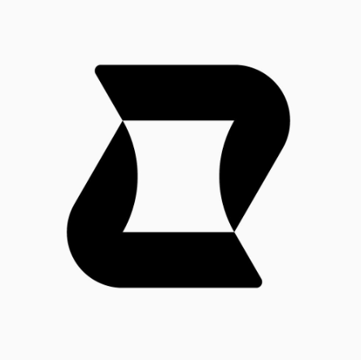

<p align="center">
  
</p>

<h1 align="center">ZakaScore</h1>

<p align="center">
  Financial intelligence for businesses with more data than they have records.
</p>

ZakaScore helps small South African businesses turn everyday sales, including cash, into a clear financial record and a credit score they can show to suppliers and lenders.

---

## What it does

- **Log sales in a chat.** Type "2 shirts, R300, cash" and it's recorded. Add bank screenshots, receipts or pasted SMS as evidence.
- **Private by design.** Uploads are read on the phone. Only money details are kept.
- **Works offline.** Sales save on the device and sync when you're back online.
- **See the business.** A dashboard shows revenue, top offerings and payment channels.
- **Build a credit profile.** A score with the reasons behind it and tips to improve it.

## How the score works

Built only from recorded sales over complete Monday to Sunday weeks. A merchant needs 4 weeks of history before getting a score.

| Factor              | Weight |
| ------------------- | ------ |
| Weekly stability    | 35%    |
| Growth              | 25%    |
| Revenue level       | 25%    |
| Trading consistency | 15%    |

> The weights are placeholders and are not yet calibrated against repayment. The score describes business activity and health. It does not predict whether a loan will be repaid.

## Plans

- **Insights:** logging, uploads, dashboard, score, one tip.
- **Full:** adds the score breakdown, all tips, forecast range and score change.

Logging is free on every plan. Plan limits are enforced on the server.

## Tech stack

Python and FastAPI, Next.js, PostgreSQL on Neon, Neon Auth.

## Quick start

```bash
# Backend
cd backend
python -m venv .venv && source .venv/bin/activate
pip install -r requirements.txt
python -m database.init_db
uvicorn main:app --reload

# Frontend
cd frontend
npm install
npm run dev
```

You'll need Python 3.10+, a current Node.js LTS, and a PostgreSQL database with a Neon Auth project.

## Read more

| Topic                                               | Where                                                        |
| --------------------------------------------------- | ------------------------------------------------------------ |
| Business, the problem and who it's for              | [backend/docs/business.md](backend/docs/business.md)         |
| Scale: how the product and business grow            | [backend/docs/scale.md](backend/docs/scale.md)               |
| Developer guide: API, data model, scoring, recipes  | [backend/docs/developer-guide.md](backend/docs/developer-guide.md) |
| Architecture                                        | [backend/docs/architecture.md](backend/docs/architecture.md) |
| Roadmap                                             | [backend/docs/roadmap.md](backend/docs/roadmap.md)           |

## License

Released under the MIT License.

**Built by Jabulani Mokoena**
